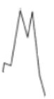
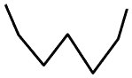

# Stock Chart Pattern Recognition with CNN

An educational convolutional neural network (CNN) implemented in Python with TensorFlow/Keras to classify images of financial price charts as **Double Top** or **Double Bottom**. Developed independently as the CNN component of a university Neural Networks course project.

## Example chart patterns

The dataset contains chart images labeled as Double Top or Double Bottom. Two examples from the included Kaggle dataset are shown below.

| Double Top | Double Bottom |
|:---:|:---:|
|  |  |

## Project overview

- **Task:** binary image classification of Double Top and Double Bottom patterns.
- **Dataset:** 340 labeled JPEG images, equally divided between Double Top (170) and Double Bottom (170).
- **Input:** RGB images resized to 128 × 128 and normalized to [0, 1].
- **Data split:** 80% training / 20% validation, using a fixed split seed (123).
- **Architecture:** Conv2D (32, 64, 128 filters, 3 × 3) + MaxPooling2D after each layer, Flatten, Dense(128, ReLU), Dropout(0.5), and a two-unit Softmax output.
- **Training:** SGD (learning rate 0.01, momentum 0.9), sparse categorical cross-entropy, 10 epochs.

## Results

The model correctly classified **67 out of 68 validation images (98.5% accuracy, approximately 99%)**.

### Validation confusion matrix

| Actual class | Predicted Double Bottom | Predicted Double Top |
|---|---:|---:|
| Double Bottom | 38 | 1 |
| Double Top | 0 | 29 |

### Interpretation

Training loss decreased over the epochs, while validation loss began increasing after approximately epoch 4, suggesting overfitting.

## Files

- `main.py`: CNN implementation, training, and evaluation.
- `Patterns.csv`: labels and image metadata, with relative paths to original chart images.
- `requirements.txt`: Python dependencies.
- `Patterns/`: 340 dataset images (redistributed with source attribution, per dataset permissions confirmed by the project author).
- `.gitignore`: ignores generated outputs and local development artifacts.

## Running locally

1. Create and activate a Python virtual environment, then run `pip install -r requirements.txt`.
2. The dataset images are included in `Patterns/`. Keep that directory next to `main.py` and `Patterns.csv`.
3. From the project root, run `python main.py`. This starts training; TensorFlow must be supported by your Python environment.

The script creates the class-organized `data/` folder, trains the model, and displays plots and a classification report. It is an interactive research script, not a deployed application.

**Dataset source:** [Stock Chart Patterns on Kaggle, uploaded by mustaphaelbakai](https://www.kaggle.com/datasets/mustaphaelbakai/stock-chart-patterns). Dataset credit goes to its original creator/uploader; the classification model and CNN analysis are separate work. Confirm any relevant dataset license terms before further redistribution.
